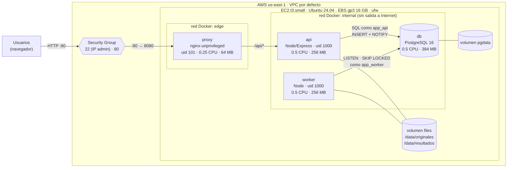
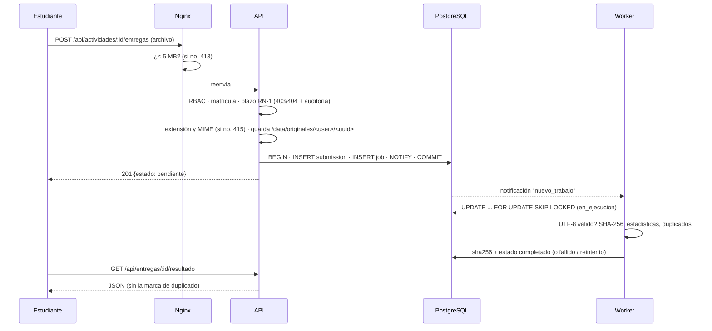

# Diagrama de arquitectura

GitHub dibuja este diagrama automáticamente. Para el documento PDF se puede exportar desde
<https://mermaid.live> (pegar el bloque y descargar como PNG o SVG).

`api` está conectada a las dos redes: a `edge` para que el proxy la alcance y a `internal` para
hablar con la base de datos. `worker` y `db` solo están en `internal`.

## Flujo de una entrega

